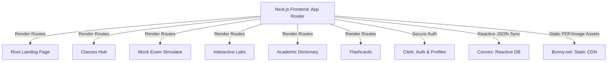

# POP Studying 🎓

An all-in-one Educational Platform designed for secondary students at **Amnuay Silpa School (ANS)** in Bangkok, Thailand, to prepare for IGCSE and A-Level examinations. 

Built to prioritize zero-distraction active learning, **POP Studying** replaces generic revision summaries with high-fidelity visual simulations, rigorous curriculum-aligned topic journeys, and real-time mock exam environments.

---

## 🚀 Key Features

### 1. Interactive Laboratories & Visualizers
* **Kinematics & Force Simulators**: Interactive graphing and object movement models driven by physics variables.
* **Equation Rearrangement Solver**: A step-by-step algebraic breakdown that isolates any chosen variable (e.g., solving for $u$, $a$, or $t$ in kinematics equations) dynamically.
* **Core Science Laboratories**: Interactive simulations (vector addition, Archimedes' buoyant force blocks, unit circle trigonometrics, titration curves, Bohr atomic builders) with slider parameter adjustments and real-time coordinate plotting.

### 2. Curriculum-Aligned Classes
* Mapped to **ANS Syllabus Standards** across Mathematics, Physics, Chemistry, Biology, and Computer Science.
* Organized by three core difficulty tiers:
  * **Beginner** (Grades 1-3) — Core foundational concepts.
  * **Intermediate** (Grades 4-6) — Deeper application-level learning.
  * **Advance** (Grades 7-9) — Rigorous exam prep questions.

### 3. Mini Mock Exam Simulator
* Timed exam simulators that replicate CIE/Edexcel formats.
* Supports both multiple-choice and short-answer text grading.
* Equipped with digital scratchpad utilities, formula reference sheets, and interactive periodic tables directly inside the exam view.

### 4. Searchable Academic Dictionary & Flashcards
* Exhaustive technical glossary containing over **254+ core terms** with zero abbreviations or simplified terms.
* Each definition contains a 6-attribute analysis: Definition, Primary Classroom Methodology, Mathematical Model (equations & units), Real-world Contextual Applications, Common Misconceptions/Examiner Insights, and Relational Schema connections.

---

## 🛠️ Architecture & Tech Stack

The application is built on a serverless, reactive structure optimized for speed, cost efficiency, and high interactivity.



* **Frontend Framework**: **Next.js (v16.2.3)** App Router & **React (v19.2.4)**
* **Styling**: **Tailwind CSS (v4)** & **Framer Motion (v12)**
* **Backend Database**: **Convex (v1.34.1)** Serverless Reactive DB
* **Authentication**: **Clerk Auth (@clerk/nextjs v7)**
* **Asset CDN**: **Bunny.net** (PDF worksheets, formula sheets, static graphics)

---

## 📂 Project Directory Structure

```plaintext
pop/
├── convex/                      # Convex schema definitions and mutations
├── public/                      # Static assets (images, icons)
├── src/
│   ├── app/                     # Next.js App Router (Root-Level Routes)
│   │   ├── (auth)/              # Clerk login and signup paths
│   │   ├── classes/             # Study courses & mock exam environments
│   │   ├── dictionary/          # Searchable technical dictionary
│   │   ├── flashcards/          # Revision cards & study modules
│   │   ├── interactives/        # Authoritative simulation laboratories
│   │   ├── learn/               # Main lessons text viewer
│   │   ├── physics-rush/        # Physics module board and kinematics visualizer
│   │   ├── globals.css          # Tailwind CSS global variables
│   │   ├── layout.tsx           # Global HTML wrapper & provider registry
│   │   └── page.tsx             # Main Landing Page
│   └── components/              # Shared reusable components
│       └── ConvexClientProvider.tsx
├── package.json                 # Dependencies and npm scripts
└── tsconfig.json                # TypeScript compiler config
```

---

## 💻 Developer Guide & Setup

### Prerequisites
Ensure you have **Node.js (v18+)** and **npm** installed on your system.

### Installation
1. Clone the repository and navigate to the project directory:
   ```bash
   cd documents/POP/pop
   ```
2. Install dependencies:
   ```bash
   npm install
   ```

### Running Locally
1. Start the serverless backend database:
   ```bash
   npx convex dev
   ```
2. Start the Next.js development server:
   ```bash
   npm run dev
   ```
3. Open [http://localhost:3000](http://localhost:3000) in your browser.

### Quality Verification
Run the compiler type-checks and code formatting linter:
```bash
npm run lint
```
To run a full production build:
```bash
npm run build
```
