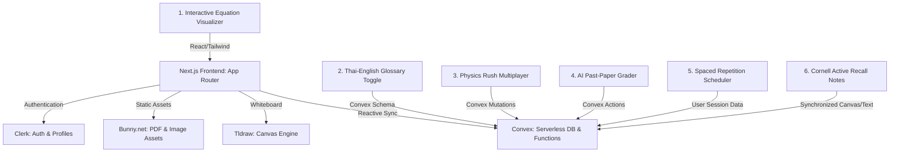

# Proposed Features for POP Studying

This document outlines **six premium feature proposals** designed to elevate **POP Studying** from a simple curriculum repository to a state-of-the-art, interactive, and gamified educational platform tailored specifically for Year 9–13 students at **Amnuay Silpa School (ANS)** in Bangkok.

---

## 🛠️ Architecture & Integration Map

The diagram below illustrates how the proposed features integrate with your existing Next.js App Router, Convex, Clerk, and Bunny.net stack, with optional Upstash caching.



---

## 💡 Feature Details

### 1. Interactive Equation Visualizer & Step-by-Step Solver
* **Target Subjects**: Physics (Kinematics, Electricity, Waves) and Mathematics.
* **Problem**: Memorizing formulas (e.g., $v^2 = u^2 + 2as$ or $F = G \frac{m_1 m_2}{d^2}$) is boring and doesn't teach relational behavior (e.g., how doubling distance cuts gravitational force to a quarter).
* **Proposed Solution**: 
  An interactive page inside [coursera/physics-rush](file:///Users/phil/Documents/POP/pop/src/app/coursera/physics-rush) or a separate math dashboard. Students slide control bars to modify variable inputs and watch real-time graphs adjust.
  
  > [!TIP]
  > Include a **"Rearrange Mode"** that dynamically demonstrates step-by-step algebraic steps to isolate any chosen variable (e.g., isolating $a$ or $u$).

* **Tech Stack**: 
  - **Frontend**: Framer Motion for animations, standard SVG or HTML5 canvas for custom physics simulations (e.g., throwing a projectile).
  - **Math Rendering**: React 19 Client component rendering mathematical formulas using standard LaTeX.

---

### 2. Thai-English Bilingual Glossary Toggle & Pronunciation Guides
* **Target Subjects**: Biology, Chemistry, and Computer Science (high vocabulary load).
* **Problem**: ANS is a bilingual Thai-UK curriculum school. EAL (English as an Additional Language) students often understand the scientific concept in Thai but struggle with English terminology on Cambridge/Edexcel exams.
* **Proposed Solution**: 
  Add a dual-language toggle button (`TH / EN`) on terms in the [dictionary/](file:///Users/phil/Documents/POP/pop/src/app/coursera/dictionary) layout.
  
  ```
  +---------------------------------------------------+
  | Mitochondria [ไมโทคอนเดรีย]            [🔈 Speak]  |
  | Definition (EN): Double-membraned organelle...    |
  | Definition (TH): ออร์แกเนลล์ที่มีเยื่อหุ้มสองชั้น... |
  +---------------------------------------------------+
  ```
* **Tech Stack**:
  - **Database**: Update Convex `schema.ts` to support optional Thai translation fields on dictionary entries.
  - **Speech**: Integration with the native web browser `SpeechSynthesis` API to let students hear the correct English pronunciation of advanced words (e.g., "Stoichiometry", "Centripetal").

---

### 3. Gamified "Physics Rush" Multiplayer Battle Room
* **Target Subjects**: Quick reviews across all syllabus topics.
* **Problem**: Flashcards and glossary drills can become repetitive and solitary.
* **Proposed Solution**: 
  Make [physics-rush](file:///Users/phil/Documents/POP/pop/src/app/coursera/physics-rush) a live gamified study room where 2 to 4 peers compete. Players are shown quick equation or definition questions and race to choose the correct answer. Speed and streaks multiply their score.
* **Tech Stack**:
  - **Real-time Sync**: Convex is perfectly suited for this. Since Convex automatically pushes updates to all connected subscribers, you can store `gameSessions` in your schema and sync active lobbies in real time without dealing with WebSocket setup.
  - **Leaderboards**: Store total points in the Convex `users` table to display a school-wide leaderboard.

---

### 4. AI-Assisted Mock Exam Grading
* **Target Subjects**: Mini Mock Exams.
* **Problem**: Students write mock answers but don't know if they hit specific mark-scheme checkpoints ("Examiner Insight") without teacher review.
* **Proposed Solution**: 
  When a student completes a mini-mock essay or short-answer question, they submit their response. The app cross-references their text against the official mark scheme and highlights matched keywords (e.g., "requires *activation energy*", "forces are *unbalanced*"), assigning estimated grades based on Cambridge threshold boundaries.
* **Tech Stack**:
  - **Convex Actions**: Use serverless Convex Actions to securely invoke a lightweight LLM API.
  - **Feedback System**: Save the graded report and AI annotations back to Convex so students can view them on their dashboard.

---

### 5. Spaced Repetition (Leitner System) Scheduler
* **Target Subjects**: Glossary vocabulary and formula retention.
* **Proposed Solution**: 
  Upgrade the [flashcards/](file:///Users/phil/Documents/POP/pop/src/app/coursera/flashcards) section to use a structured Leitner Box system (Boxes 1–5):
  
  | Box | Interval | Action on Correct | Action on Incorrect |
  | :--- | :--- | :--- | :--- |
  | **Box 1** | Every Day | Move to Box 2 | Stay in Box 1 |
  | **Box 2** | Every 3 Days | Move to Box 3 | Return to Box 1 |
  | **Box 3** | Every Week | Move to Box 4 | Return to Box 1 |
  | **Box 4** | Every 2 Weeks | Move to Box 5 | Return to Box 1 |
  | **Box 5** | Every Month | Completed / Archive | Return to Box 1 |

* **Tech Stack**:
  - **Database**: A `userFlashcardState` table in Convex mapping `clerkId`, `cardId`, `boxNumber` (1-5), and `nextReviewTimestamp`.

---

### 6. Cornell-Style Active Recall Notes Tool
* **Target Subjects**: Subject-specific resources and class progress tracking.
* **Proposed Solution**: 
  An editor pane within the study modules where students take notes using the Cornell method (divided into three sections: Keywords/Questions in the left margin, Detail notes in the center, and a Summary at the bottom).
  
  > [!IMPORTANT]
  > Add an **Active Recall Toggle**: With a single click, the notes on the right column are hidden, leaving only the student's handwritten cue questions. The student must answer their cues before revealing their full notes.

* **Tech Stack**:
  - **Rich Text / Drawing**: Integrate with your existing `<Tldraw />` canvas in the sidebar or a structured React form to save state directly to Convex.

---

## 📊 Feature Comparison & Feasibility

This table evaluates each proposed feature by user value, development complexity, and estimated monthly operational cost to ensure the platform remains within free-tier budgets.

| Feature | Student Value | Dev Complexity | Est. Extra Cost | Priority |
| :--- | :--- | :--- | :--- | :--- |
| **Bilingual Toggle** | 🌟 Very High | 🟢 Low | $0.00 (Free Tier) | **P0** (Quick Win) |
| **Leitner Flashcard Scheduler** | 🌟 High | 🟡 Medium | $0.00 (Convex) | **P1** (Core Revamp) |
| **Interactive Equation Visualizer** | 🌟 High | 🟡 Medium | $0.00 (Client-side) | **P1** |
| **Cornell Active Recall Notes** | 🌟 Medium | 🟡 Medium | $0.00 (Convex) | **P2** |
| **Physics Rush Multiplayer** | 🌟 Very High | 🔴 High | $0.00 (Convex DB) | **P2** |
| **AI Mock Paper Grader** | 🌟 High | 🔴 High | Low ($0.01/call) | **P3** (Budget Bound) |

---

## 🚀 Recommendation Roadmap

1. **Step 1 (Quick Win)**: Update [dictionary/page.tsx](file:///Users/phil/Documents/POP/pop/src/app/coursera/dictionary/page.tsx) with a **Bilingual Thai-English Toggle** using your existing dictionary database.
2. **Step 2 (UX Booster)**: Modify the database schema in [schema.ts](file:///Users/phil/Documents/POP/pop/convex/schema.ts) to track study sessions and Leitner box progression for the flashcards.
3. **Step 3 (Gamification)**: Build out a basic real-time game lobby in [physics-rush](file:///Users/phil/Documents/POP/pop/src/app/coursera/physics-rush) utilizing Convex mutations to sync scores between students.
